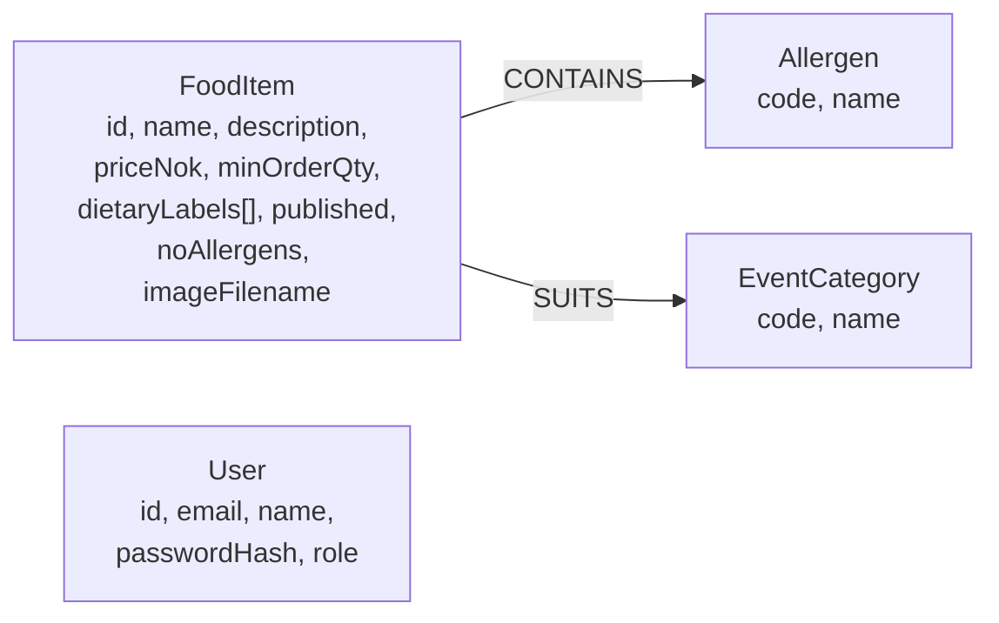
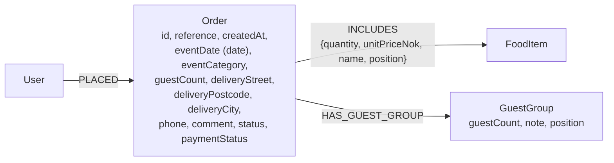
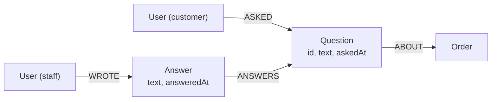

# Graph data model (Neo4j)

Current version, as implemented in `app/models/neo4j_repos.py`. Extend it as features are added: orders, order lines, guest-group diets and questions.

## Constraints

Created by `ensure_schema()` in `app/models/neo4j_db.py`:
- `FoodItem.id` is unique.
- `User.id` and `User.email` are unique. E-mail is stored in lowercase.
- `Allergen.code` and `EventCategory.code` are unique.

## Mapping from the domain model

| Domain class (`app/models/domain.py`) | Graph |
|---|---|
| `FoodItem` | `:FoodItem` node |
| `FoodItem.allergens` | `CONTAINS` relationships to `:Allergen` nodes (the 14 EU allergens) |
| `FoodItem.event_categories` | `SUITS` relationships to `:EventCategory` nodes |
| `FoodItem.dietary_labels` | List property on the node |
| `FoodItem.image_filename` | `imageFilename`: content-hash name (`<32 hex>.jpg`) of a file in the image store, not stored in the graph itself |
| `FoodItem.no_allergens` | `noAllergens` property: staff confirmed the item has none of the 14 allergens (US-33) |
| `User` (customers and admins) | `:User` node, where `role` is `customer` or `admin` |

## Why allergens and event categories are nodes

Allergens and event categories are nodes rather than list properties, because the planned features query along them. The menu by event (C1) and the kitchen view of the day's orders with allergies highlighted (Mateo) can then be written as traversals, for example `(:Order)-[:INCLUDES]->(:FoodItem)-[:CONTAINS]->(:Allergen {code: 'nuts'})`.

Dietary labels are only displayed, so they stay a simple property.

## Orders (C2/C3)

- `INCLUDES` copies the name and price when the order is placed, so changing the menu later doesn't change old orders. A food item that has been ordered can't be deleted, only unpublished.
- `GuestGroup` stores a count and a note, such as "2: nut allergy", but never guest names (US-36, GDPR art. 9).
- Constraints: `Order.id` and `Order.reference` are unique.

## Questions and answers (C5, A4)

- A question has at most one answer. Answering again replaces it (`QuestionRepository.answer`).
- Constraint: `Question.id` is unique.
