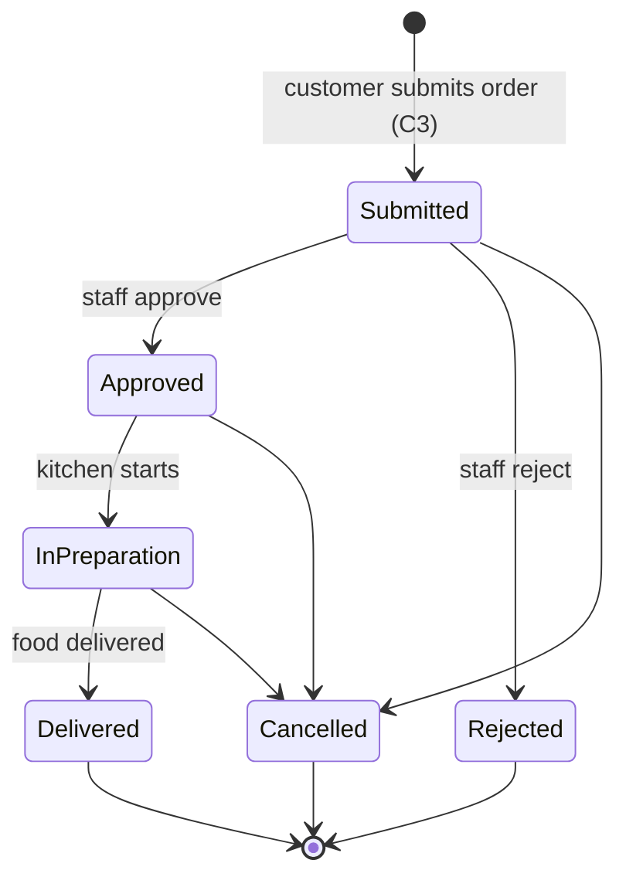

# Order status: state machine

How an order's status can change in Ekte Mat Online (A3). It is implemented in `app/models/order_status.py`, and `tests/test_order_status.py` checks every pair of statuses.

- **Final statuses:** Delivered, Rejected and Cancelled can't be changed.
- **Open orders:** Submitted, Approved and In preparation. The admin order list shows these by default.
- **Payment status** (not paid, deposit paid, invoiced, paid) is a separate field. Staff can set any value at any time, for example to correct a mistake.

## Difference from the lab model

The lab state machine (`02_uml_state-machine-order_2026-10-20.puml`) has more states: Requested, Quoted, AwaitingDeposit, Confirmed with nested allergy states, NumbersConfirmed and Invoiced. This assignment asks for the simpler life cycle above, so that is what the app implements.

- **Quoting and the wedding deposit** are not separate states. Payment is tracked in the separate payment status instead.
- **Invoicing** is also a payment status rather than an order status.
